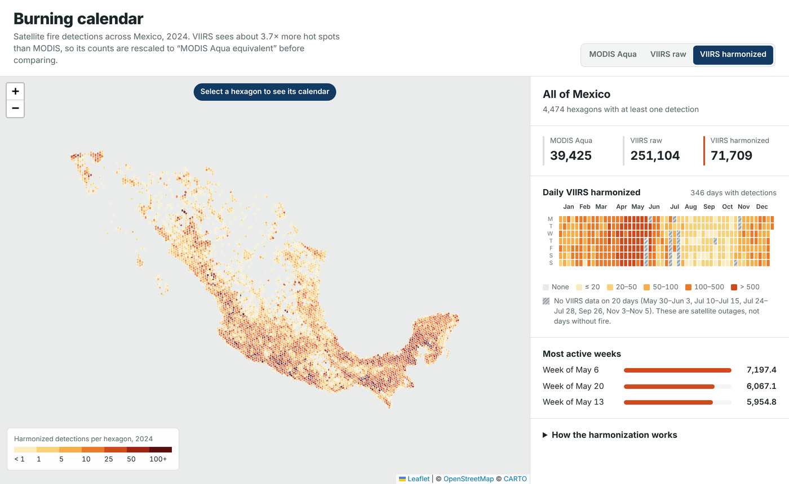
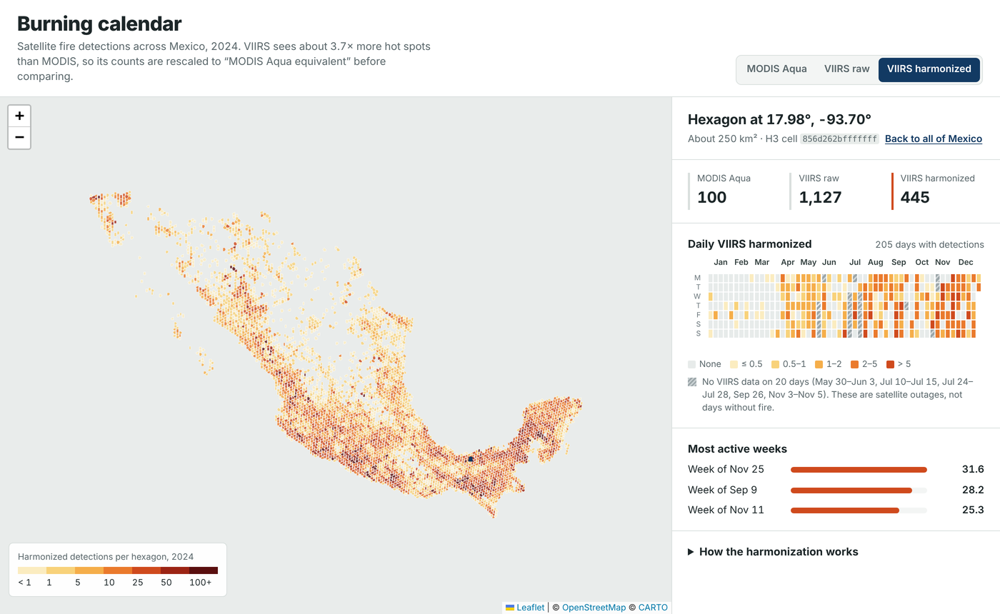
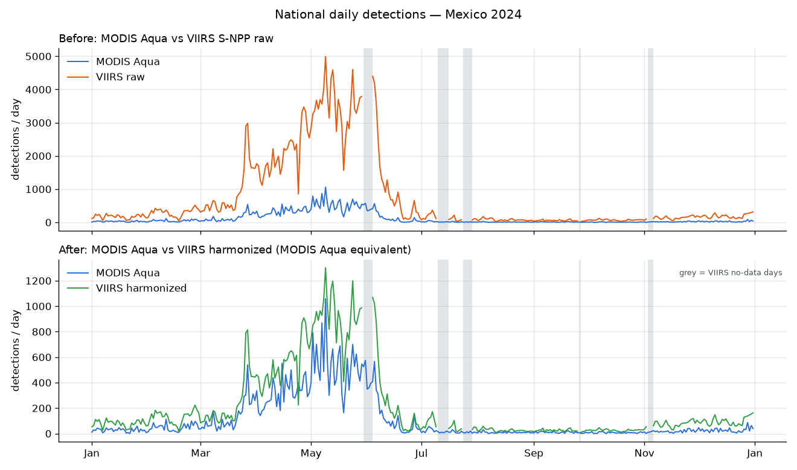

# Burning calendar: harmonized MODIS + VIIRS fire detections (Mexico, 2024)

Prototype for the NASA Space Apps Challenge 2026 challenge
**"Harmonization of MODIS and VIIRS Hot Spots"**.

Satellites have mapped active fires for more than 20 years, but with two different
instruments. **MODIS** (since 2000, ~1 km pixels) and **VIIRS** (since 2012, 375 m pixels)
see fire very differently: VIIRS detects about 3.7 times more hot spots in the same place
on the same day, and it also catches many small fires that MODIS misses. If the two records
are joined without correction, fire activity seems to jump just because the instrument changed.

This prototype harmonizes both records on an H3 hexagon grid for **Mexico in 2024**
and shows a **daily burning calendar** for the whole country or for any hexagon.

**Live demo:** https://denzelpereyda0248.github.io/PruebaNASA/





## What the app does

- A map of Mexico divided into ~250 km² hexagons, colored by harmonized detections in 2024.
- Select a hexagon to see its 2024 calendar, one square per day.
- Switch between **MODIS Aqua**, **VIIRS raw** and **VIIRS harmonized**.
- Totals per series and the three most active weeks.
- Days when VIIRS has no data (satellite outages) are hatched in grey, never shown as zero.
- With no hexagon selected, the calendar shows the whole country.

## Quick start

Requirements: [uv](https://docs.astral.sh/uv/) (Python 3.12 is installed automatically) and Node.js 20+.

```bash
# 1. Python environment
uv sync

# 2. Input data (not in Git): put the two FIRMS CSVs in data/raw/
#    modis_2024_Mexico.csv, viirs-snpp_2024_Mexico.csv
uv run python -m pipeline.download      # checks them, tries to download if missing

# 3. Whole pipeline: reports in data/reports/, JSON in web/public/data/
uv run python -m pipeline.run_all
uv run pytest

# 4. Web app
cd web
npm install
npm run dev        # http://localhost:5173
npm run build      # static site in web/dist/
```

The exported JSON is committed, so step 4 works without running the pipeline.

## Data

[NASA FIRMS](https://firms.modaps.eosdis.nasa.gov/) Country Yearly Summary, Mexico, 2024:

| Source | Satellites | Raw detections | After filters |
|---|---|---|---|
| MODIS Collection 6.1 | Terra, Aqua | 80,390 | 68,609 |
| VIIRS 375 m (VNP14IMG) | Suomi NPP | 330,134 | 251,104 |

Filters: presumed vegetation fires only (`type = 0`; volcanoes, industrial and offshore
sources removed), MODIS confidence ≥ 30, VIIRS confidence nominal or high. Dates are
converted from UTC to local time with a fixed UTC−6 offset.

VIIRS S-NPP has **no data at all on 20 days of 2024** (May 30–Jun 3, Jul 10–15,
Jul 24–28, Sep 26, Nov 3–5). These are outages, so they are exported as missing values.

## Harmonization method (`monthly_ratio_v1`)

1. Count detections per H3 cell (resolution 5) and local day.
2. Take the cell-days where **both** MODIS Aqua and VIIRS S-NPP see at least one fire.
   Aqua is the reference because it passes over Mexico in the early afternoon, like S-NPP.
3. Monthly factor = sum(MODIS Aqua) / sum(VIIRS) over those cell-days.
4. `viirs_h = VIIRS × factor` gives VIIRS in "MODIS Aqua equivalent".

### Results (full report: [`data/reports/03_validacion.md`](data/reports/03_validacion.md))

- Annual factor **0.271** (one MODIS Aqua detection per ~3.7 VIIRS detections).
  Monthly factors range from 0.24 in the fire season to 0.54 in the wet season.
- **The timing matches well.** Daily national correlation with MODIS Aqua is r = 0.95,
  and at cell-week level r = 0.79.
- **The totals do not match yet.** Harmonized VIIRS adds up to 1.94× MODIS Aqua, because
  54% of VIIRS detections fall in cell-days where MODIS Aqua sees nothing (small fires).
  A factor computed from all cell-days matches the totals and keeps the same correlation;
  it is documented in the report as the next candidate method.
- In leave-one-month-out validation, a single annual factor does as well as or better than
  monthly factors in 9 of 12 months.



## Limitations

- One year only, so there is no "normal year" to compare against yet.
- Counts of hot pixels, not burned area or number of fires.
- Harmonized totals are about twice MODIS Aqua (see above). Use the calendar to see
  **when** burning happens, not exact counts.
- One time zone (UTC−6) for the whole country.
- Days with partial VIIRS coverage are not flagged and may look like low activity.
- A few hexagons with detections all year round may be industrial heat sources that
  FIRMS still labels as vegetation fire.

## Deploy

The web app is a static site.

**GitHub Pages (current):** every push to `main` that touches `web/` runs
[`.github/workflows/pages.yml`](.github/workflows/pages.yml), which builds the app with
`VITE_BASE=/PruebaNASA/` and publishes it to the `gh-pages` branch.

**Vercel (alternative):** settings for the `web/` folder are in
[`web/vercel.json`](web/vercel.json).

1. Push this repository to GitHub.
2. In Vercel: **Add New → Project**, import the repository.
3. Set **Root Directory** to `web`. Vercel detects Vite (build `npm run build`, output `dist`).
4. Deploy.

Netlify works the same way: base directory `web`, build command `npm run build`,
publish directory `web/dist`.

## Repository structure

```text
pipeline/      Python steps: download, inspect_data, clean, grid, harmonize, validate, export, run_all
tests/         pytest
data/raw/      FIRMS CSVs (not in Git)
data/interim/  Parquet intermediates (not in Git)
data/reports/  exploration and validation reports with charts
web/           Vite + React + TypeScript app; web/public/data/ holds the exported JSON
```

## License

MIT. Fire data courtesy of NASA FIRMS. Basemap © OpenStreetMap contributors, © CARTO.
