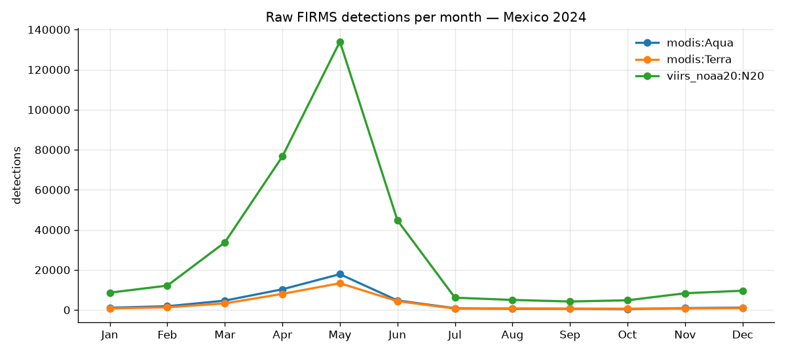

# 01 — Data exploration (Mexico, 2024)

Generated 2026-11-08T04:10:01+00:00 by `pipeline/inspect_data.py`.
Raw files, no filters applied.

## Files

| key | file | role | rows |
|---|---|---|---|
| modis | `modis_2024_Mexico.csv` | method input | 80,390 |
| viirs | `viirs-snpp_2024_Mexico.csv` | method input | **MISSING** |
| viirs_noaa20 | `viirs-jpss1_2024_Mexico.csv` | alternative (not in scope) | 347,959 |

## NASA FIRMS MODIS C6.1 (`modis`)

### Rows by satellite

| satellite | rows | share |
|---|---|---|
| Aqua | 44,962 | 55.9% |
| Terra | 35,428 | 44.1% |

### Columns and types

| column | dtype | example |
|---|---|---|
| latitude | float64 | 30.4957 |
| longitude | float64 | -109.6295 |
| brightness | float64 | 304.4 |
| scan | float64 | 1.0 |
| track | float64 | 1.0 |
| acq_date | datetime64[us] | 2024-01-01 00:00:00 |
| acq_time | str | 0450 |
| satellite | str | Terra |
| instrument | str | MODIS |
| confidence | str | 60 |
| version | float64 | 61.03 |
| bright_t31 | float64 | 275.1 |
| frp | float64 | 11.5 |
| daynight | str | N |
| type | int64 | 2 |

### `type`

| type | meaning | rows | share |
|---|---|---|---|
| 0 | vegetation fire | 71,872 | 89.4% |
| 1 | active volcano | 69 | 0.1% |
| 2 | other static land source | 8,195 | 10.2% |
| 3 | offshore | 254 | 0.3% |

### `confidence`

| confidence class | rows | share |
|---|---|---|
| high (80-100) | 25,252 | 31.4% |
| low (0-29) | 3,838 | 4.8% |
| nominal (30-79) | 51,300 | 63.8% |

Numeric summary: min 0, median 71, max 100.

### `daynight`

| daynight | rows | share |
|---|---|---|
| D | 58,928 | 73.3% |
| N | 21,462 | 26.7% |

### Overpass hours (UTC, `acq_time`)

| satellite | daynight | hour range (UTC) |
|---|---|---|
| Aqua | D | 19–22 |
| Aqua | N | 07–10 |
| Terra | D | 15–18 |
| Terra | N | 02–05 |

### Coverage

- Date range: 2024-01-01 to 2024-12-31 (366 distinct days)
- Bounding box: lon -117.076 to -86.909, lat 14.593 to 32.674
- FRP (MW): median 19.1, p95 107.3, max 4758.8

### Checks

- No issues found.

## NASA FIRMS VIIRS NOAA-20 375 m (`viirs_noaa20`)

### Rows by satellite

| satellite | rows | share |
|---|---|---|
| N20 | 347,959 | 100.0% |

### Columns and types

| column | dtype | example |
|---|---|---|
| latitude | float64 | 20.94744 |
| longitude | float64 | -89.6662 |
| bright_ti4 | float64 | 310.14 |
| scan | float64 | 0.49 |
| track | float64 | 0.65 |
| acq_date | datetime64[us] | 2024-01-01 00:00:00 |
| acq_time | str | 0651 |
| satellite | str | N20 |
| instrument | str | VIIRS |
| confidence | str | n |
| version | int64 | 2 |
| bright_ti5 | float64 | 288.91 |
| frp | float64 | 1.8 |
| daynight | str | N |
| type | int64 | 2 |

### `type`

| type | meaning | rows | share |
|---|---|---|---|
| 0 | vegetation fire | 310,672 | 89.3% |
| 1 | active volcano | 226 | 0.1% |
| 2 | other static land source | 36,158 | 10.4% |
| 3 | offshore | 903 | 0.3% |

### `confidence`

| confidence | rows | share |
|---|---|---|
| h | 17,194 | 4.9% |
| l | 46,955 | 13.5% |
| n | 283,810 | 81.6% |

### `daynight`

| daynight | rows | share |
|---|---|---|
| D | 219,541 | 63.1% |
| N | 128,418 | 36.9% |

### Overpass hours (UTC, `acq_time`)

| satellite | daynight | hour range (UTC) |
|---|---|---|
| N20 | D | 18–21 |
| N20 | N | 06–10 |

### Coverage

- Date range: 2024-01-01 to 2024-12-31 (365 distinct days)
- Bounding box: lon -117.104 to -86.830, lat 14.563 to 32.703
- FRP (MW): median 4.8, p95 27.2, max 1108.8

### Checks

- ⚠️ 1 exact duplicate detections (same lat/lon/date/time/satellite)
- ⚠️ 1 day(s) with no detections at all: 2024-02-04

## Detections per month (raw, all types and confidences)

| month | modis:Aqua | modis:Terra | viirs_noaa20:N20 |
|---|---|---|---|
| Jan | 1,099 | 744 | 8,630 |
| Feb | 1,850 | 1,305 | 12,145 |
| Mar | 4,647 | 3,253 | 33,733 |
| Apr | 10,304 | 8,025 | 76,638 |
| May | 17,860 | 13,337 | 133,996 |
| Jun | 4,737 | 4,384 | 44,748 |
| Jul | 845 | 664 | 6,109 |
| Aug | 606 | 775 | 4,996 |
| Sep | 545 | 643 | 4,215 |
| Oct | 408 | 641 | 4,817 |
| Nov | 907 | 713 | 8,335 |
| Dec | 1,154 | 944 | 9,597 |
| **total** | 44,962 | 35,428 | 347,959 |

