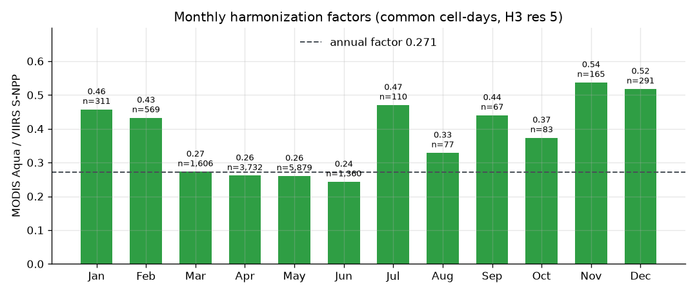
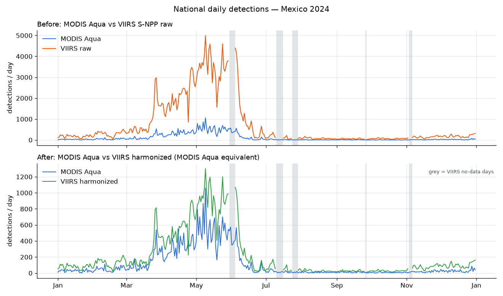
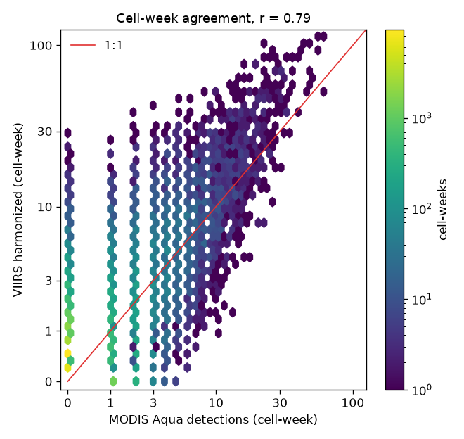

# 03 — Harmonization v1 and validation (Mexico, 2024)

Generated 2026-11-08T04:24:52+00:00 by `pipeline/validate.py`.

## Summary

- Method `monthly_ratio_v1`: VIIRS S-NPP × monthly factor = "MODIS Aqua equivalent".
- Annual factor **0.271**: on cell-days where both sensors see fire, MODIS Aqua reports about 0.27 detections per VIIRS detection (≈ 1 per 3.7).
- Factors range from 0.24 (fire season) to 0.54 (wet season); no month needed the annual fallback.
- Timing agrees well: national daily Pearson r = **0.95**, cell-week r = **0.79**.
- **Totals do not agree yet**: harmonized VIIRS sums to **1.94×** MODIS Aqua. 57,996 cell-days (54% of VIIRS detections) have VIIRS fire but no MODIS Aqua detection; the factor, learned only where both see fire, is applied to them too.
- Monthly factors do not beat a single factor: in the leave-one-month-out test the held-out (annual-like) factor has lower cell-week MAE in 9 of 12 months, and a single annual factor scores MAE 1.25 vs 1.33 for monthly factors.
- 20 VIIRS no-data days are excluded from every comparison and exported as missing.

## Rows after each cleaning step

| sensor | step | rows |
|---|---|---|
| modis | raw | 80,390 |
| modis | drop_exact_duplicates | 80,390 |
| modis | local_date_in_2024 | 80,388 |
| modis | type_in_[0] | 71,871 |
| modis | confidence | 68,609 |
| viirs | raw | 330,134 |
| viirs | drop_exact_duplicates | 330,134 |
| viirs | local_date_in_2024 | 330,134 |
| viirs | type_in_[0] | 293,133 |
| viirs | confidence | 251,104 |

## Monthly factors

Common cell-days = H3 res 5 cell and local day where MODIS Aqua ≥ 1 and VIIRS S-NPP ≥ 1. Fallback to the annual factor below 30 common cell-days.

| month | common_cell_days | modis_aqua_sum | viirs_sum | factor_month | fallback_annual | factor |
|---|---|---|---|---|---|---|
| 2024-01 | 311 | 538 | 1,176 | 0.457 | no | 0.457 |
| 2024-02 | 569 | 960 | 2,219 | 0.433 | no | 0.433 |
| 2024-03 | 1,606 | 3,432 | 12,572 | 0.273 | no | 0.273 |
| 2024-04 | 3,732 | 8,307 | 31,748 | 0.262 | no | 0.262 |
| 2024-05 | 5,879 | 13,840 | 53,082 | 0.261 | no | 0.261 |
| 2024-06 | 1,360 | 2,620 | 10,777 | 0.243 | no | 0.243 |
| 2024-07 | 110 | 183 | 389 | 0.470 | no | 0.470 |
| 2024-08 | 77 | 151 | 459 | 0.329 | no | 0.329 |
| 2024-09 | 67 | 129 | 293 | 0.440 | no | 0.440 |
| 2024-10 | 83 | 127 | 340 | 0.374 | no | 0.374 |
| 2024-11 | 165 | 230 | 428 | 0.537 | no | 0.537 |
| 2024-12 | 291 | 433 | 836 | 0.518 | no | 0.518 |

## National daily series

## Agreement at cell-week level

Cell-week = H3 res 5 cell × Monday-based week; only cell-weeks with any detection. Mean error = mean(series − MODIS Aqua). Total ratio = sum(series) / sum(MODIS Aqua) (1.00 = same totals).

| series vs MODIS Aqua | cell-weeks | Pearson r | Spearman ρ | mean error | MAE | total ratio |
|---|---|---|---|---|---|---|
| VIIRS raw (no harmonization) | 39,743 | 0.796 | 0.402 | +5.39 | 5.54 | 6.78 |
| VIIRS × annual factor | 39,743 | 0.796 | 0.402 | +0.78 | 1.25 | 1.83 |
| **VIIRS × monthly_ratio_v1 (exported)** | 39,743 | 0.786 | 0.375 | +0.87 | 1.33 | 1.94 |
| VIIRS × total-ratio monthly (candidate, not exported) | 39,743 | 0.799 | 0.396 | +0.00 | 0.80 | 1.00 |

Cell-day overlap (VIIRS data days): both 14,250 · VIIRS only 57,996 · MODIS Aqua only 4,466.

## Leave-one-month-out cross-validation

For each month the factor is recomputed from the other 11 months (common cell-days) and evaluated on the held-out month.

| month | factor in-sample | factor held-out | total ratio in-sample | total ratio held-out | MAE in-sample | MAE held-out |
|---|---|---|---|---|---|---|
| 2024-01 | 0.457 | 0.269 | 2.92 | 1.72 | 1.00 | 0.67 |
| 2024-02 | 0.433 | 0.268 | 2.68 | 1.65 | 1.03 | 0.70 |
| 2024-03 | 0.273 | 0.270 | 1.77 | 1.76 | 1.15 | 1.14 |
| 2024-04 | 0.262 | 0.274 | 1.70 | 1.78 | 1.47 | 1.54 |
| 2024-05 | 0.261 | 0.279 | 1.71 | 1.83 | 1.75 | 1.90 |
| 2024-06 | 0.243 | 0.274 | 2.18 | 2.46 | 1.16 | 1.31 |
| 2024-07 | 0.470 | 0.270 | 3.55 | 2.04 | 1.04 | 0.67 |
| 2024-08 | 0.329 | 0.270 | 2.86 | 2.35 | 0.78 | 0.66 |
| 2024-09 | 0.440 | 0.270 | 2.45 | 1.51 | 1.06 | 0.74 |
| 2024-10 | 0.374 | 0.270 | 3.55 | 2.57 | 0.77 | 0.59 |
| 2024-11 | 0.537 | 0.270 | 4.30 | 2.16 | 1.10 | 0.63 |
| 2024-12 | 0.518 | 0.269 | 3.53 | 1.83 | 1.10 | 0.66 |

## Grid resolution sensitivity

| H3 res | cells with detections | common cell-days | annual factor | Pearson r (cell-week) | total ratio |
|---|---|---|---|---|---|
| 5 | 4,511 | 14,250 | 0.271 | 0.786 | 1.94 |
| 4 | 951 | 11,141 | 0.224 | 0.858 | 1.62 |

## Limitations (plain language)

- **One year only.** Factors are fitted and checked on 2024 data; they may differ in other years.
- **Totals are inflated.** The factor is learned where both satellites see fire, but VIIRS also sees many small fires where MODIS sees nothing. Multiplying those by the same factor adds detections that MODIS would not have reported. The calendar shape (when burning happens) is reliable; the absolute numbers of `viirs_h` are about twice what MODIS Aqua would show.
- **Counts, not burned area.** A detection is a hot pixel at the moment of the overpass; one fire can produce many detections and short fires between overpasses are missed.
- **Fixed UTC−6.** Local dates use one time zone for all of Mexico; a few night detections in Baja California, Sonora and Quintana Roo may fall on a neighbouring day.
- **VIIRS outages.** 20 days in 2024 have no VIIRS data at all; they are shown as "no data". Partial-coverage days (fewer orbits than usual) are not detected and look like low activity.
- **Only MODIS Aqua is the reference.** Terra (morning pass) is not used in the harmonized series.

## Open question for the team

The candidate `total-ratio monthly` row shows a simple alternative (factor from all cell-days) that matches totals by construction while keeping the same correlation. It is **not** applied; the exported data uses `monthly_ratio_v1` as specified in PLAN.md.
